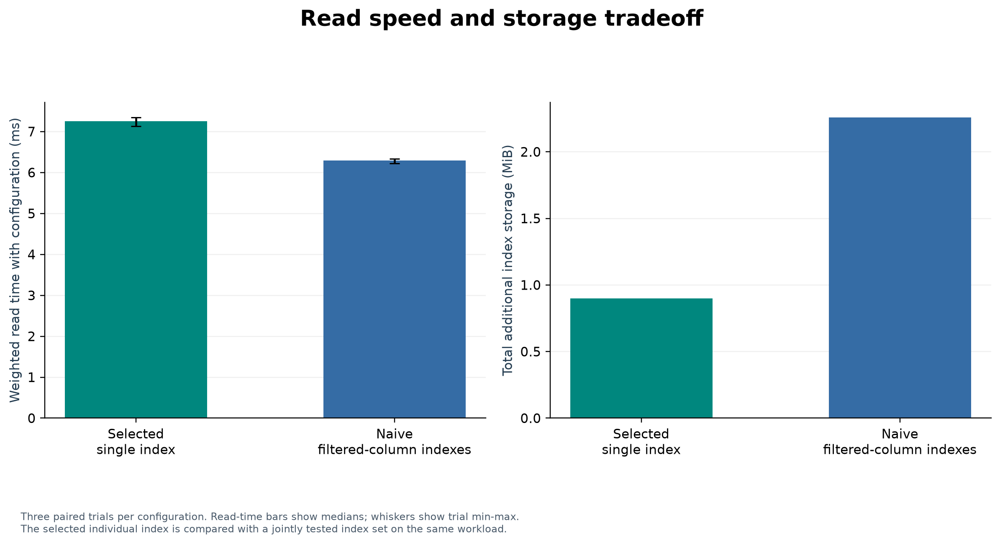

# IndexMaxxer

Database workload analysis and experimental index advice for PostgreSQL.

IndexMaxxer analyzes a supplied SQL workload, proposes single-column and two-column B-tree indexes, measures their read performance, and explains the results through recorded execution plans. A React dashboard displays the saved recommendations, per-query comparisons, and measured write costs.

The current advisor ranks **individual indexes**. Additional experiments compare the selected index with a naive index set and examine dataset size, predicate selectivity, and write overhead.

## Implemented components

| Component | Project implementation | PostgreSQL provides |
| --- | --- | --- |
| Query analyzer | Workload validation, SQL feature extraction, query-pattern grouping and frequency handling | SQL execution |
| Plan analyzer | Traversal of EXPLAIN JSON, summaries and diagnostic observations | Execution plans, estimates, actual rows and buffer counters |
| Metadata analyzer | Catalog/statistics collection and interpretation for candidate analysis | Catalogs, table statistics and existing index definitions |
| Index advisor | Candidate generation, duplicate checks, read-performance ranking and explanations | B-tree implementation and optimizer choices |
| Evaluation system | Repeated measurements, paired comparisons, index cleanup, experiment reports and exports | Query execution and transactional DDL |

FastAPI and React connect these components to a results viewer. This project does not implement PostgreSQL's storage engine, B-tree algorithms, or query optimizer.

## Recorded results

These measurements are from the committed synthetic experiments, not performance guarantees.

| Experiment | Recorded observation |
| --- | --- |
| Individual index comparison | `orders(customer_id)` reduced the frequency-weighted read score from 9.098 ms to 6.221 ms: 31.6%, with 0.90 MiB added storage. |
| Write batches | INSERT, customer-ID UPDATE, and amount UPDATE took 13.6%, 26.3%, and 15.5% longer respectively with the selected index. Each batch affected 1,000 rows. |
| Strategy comparison | The selected index measured 7.249 ms with 0.90 MiB added storage; the naive three-index set measured 6.294 ms with 2.26 MiB. These are medians across three paired trials. |
| Dataset sizes | Median paired read gains were 31.8%, 27.4%, and 22.7% at 100K, 500K, and 1M orders, with 10K customers held fixed. |
| Selectivity | Diagnostic plans used the candidate at 0.090%, 0.974%, and 9.817% actual matching rows. At 49.845%, they used sequential scans in all three trials. |

The 49.845% selectivity case recorded a 30.6% median paired timing decrease even though the candidate was unused in every diagnostic plan. Both configurations recorded 787 shared-buffer hits and zero shared blocks read. Timing also varied across trials. The cause is not established; this decrease is **not presented as demonstrated index benefit**.



## Requirements

The recorded Windows setup used Python 3.12.10, Node.js 22.14.0, npm 10.9.2, Docker Desktop with Linux containers, and PostgreSQL 17.12. Python packages are pinned in `requirements.txt`; frontend dependencies are recorded in `frontend/package-lock.json`.

The commands below use PowerShell. Run project commands from the repository root unless a different directory is shown.

## First-time setup

### 1. Get the code and dependencies

```powershell
git clone https://github.com/01Priyanshu/indexmaxxer.git
cd indexmaxxer
python -m venv .venv
.\.venv\Scripts\Activate.ps1
python -m pip install -r requirements.txt
npm --prefix .\frontend ci
```

Create the local configuration if it does not already exist:

```powershell
if (-not (Test-Path .env)) {
    Copy-Item .env.example .env
}
```

The example credentials are for local development. `.env` is excluded from Git.

### 2. Create PostgreSQL once

Start Docker Desktop and wait for its engine to become ready. For a new installation:

```powershell
docker run -d --name indexmaxxer-db --shm-size=256m -e POSTGRES_USER=indexmaxxer -e POSTGRES_PASSWORD=indexmaxxer_dev -e POSTGRES_DB=indexmaxxer -p 127.0.0.1:5433:5432 -v indexmaxxer_pgdata:/var/lib/postgresql/data postgres:17
```

Check readiness:

```powershell
docker exec indexmaxxer-db pg_isready -U indexmaxxer -d indexmaxxer
```

Wait until it reports that connections are accepted. If the container already exists, use the restart instructions below instead of creating another one.

### 3. Seed a new database once

```powershell
Get-Content -Raw experiments\seed_data.sql | docker exec -i indexmaxxer-db psql -X -v ON_ERROR_STOP=1 -U indexmaxxer -d indexmaxxer
```

This creates 10,000 customers and 100,000 orders in the `benchmark` schema. The seed script is intended for a new database: it is not an incremental loader and will fail if its tables already exist. PostgreSQL data is retained in the `indexmaxxer_pgdata` Docker volume.

Committed experiment reports can be viewed without rerunning experiments. Those reports describe the environment and data at recording time; displaying them does not benchmark the current database.

## Start or restart the application

Start Docker Desktop, then start the existing database container:

```powershell
docker start indexmaxxer-db
```

In the first PowerShell window, from the project root:

```powershell
.\.venv\Scripts\Activate.ps1
python -m uvicorn backend.main:app --reload --host 127.0.0.1 --port 8000
```

In a second PowerShell window, also from the project root:

```powershell
npm --prefix .\frontend run dev
```

- Dashboard: http://127.0.0.1:5173
- Database health check: http://127.0.0.1:8000/health
- API documentation: http://127.0.0.1:8000/docs

The Vite development server proxies `/api` requests to FastAPI. `npm run build` creates frontend assets; serving those assets in a deployed environment also requires routing API requests to the backend.

**Reload saved results** reads completed report files. It does not execute a new benchmark or apply an index. The database health check requires PostgreSQL; saved-report endpoints and graph export read files.

## Reproduce the experiments

Keep PostgreSQL running and run database experiments one at a time. The input workload is `data/workload.json`. It contains eight controlled queries with synthetic frequency weights totaling 100.

```powershell
# Optional baseline-only measurement
python -m experiments.workload_baseline

# Generate and test individual candidates; print/save recommendations
python -m experiments.compare_indexes
python -m experiments.recommend_indexes

# Measure write cost for the selected read candidate
python -m experiments.write_overhead

# Selected index versus a jointly tested naive index set
python -m experiments.compare_strategies

# Fixed selected index at 100K, 500K and 1M orders
python -m experiments.compare_scales

# Four target predicate match fractions on 100K orders
python -m experiments.compare_selectivity

# Export saved results; this command does not need a running database
python -m experiments.export_results
```

Individual candidate tests undo their added indexes using transaction rollback. Strategy comparisons use savepoints and a final rollback. Write, scale, and selectivity experiments create uniquely named schemas, remove their own generated objects, and record cleanup status. Only completed reports with verified cleanup are accepted by the relevant loaders.

If a process or database connection is forcibly terminated, inspect the failed/incomplete report before continuing. Generated schema names are recorded in the reports; do not remove the original `benchmark` schema as an experiment-cleanup step.

Re-running individual candidate selection creates a new source report. Matching write, strategy, and scale experiments should then be run for that source before exporting all five experiment sets together.

## Measurement method

- Read timing measures client `execute + fetchall`. EXPLAIN execution time and buffer counters come from separate diagnostic runs.
- Each phase uses two warmup rounds and seven measured runs per query. Query order is shuffled. No forced cache clearing is performed.
- The workload score is `sum(frequency * per-query median_ms) / sum(frequency)`. It is not total workload runtime or database-only execution time.
- Strategy, scale and selectivity experiments use three paired trials. Baseline runs first in trials 1 and 3; indexed configuration runs first in trial 2.
- A median of paired percentage changes need not equal the percentage calculated from two separately reported timing medians.
- Row counts are checked between configurations. This is not a full result-content comparison.
- The advisor's 5% read-improvement threshold is a project heuristic, not a statistical significance test.
- Root-plan buffer counters include descendant activity; node buffer counts are not summed across the tree.
- Write tests use fresh logged tables per sample, retain primary-key/foreign-key constraints, and time the statement plus commit. Setup and index construction are excluded. INSERT uses explicit IDs, so identity-sequence allocation is not measured.

## Exported artifacts

Each export creates a new `results/exports_<UTC timestamp>/` folder containing:

- Five PNG figures for slides and five editable SVG versions.
- Five CSV tables with recorded values.
- `manifest.json`, listing source report filenames, SHA-256 hashes, software versions, and interpretation notes.

Whiskers represent observed minimum-to-maximum times or paired changes, not confidence intervals. Graphs preserve the unused-index selectivity result and label its timing difference as unexplained.

## Current scope and limitations

- The workload is supplied as a file; this version does not continuously capture production traffic.
- SQL support is a controlled subset of SELECT queries. The analyzer is not a security boundary for arbitrary untrusted SQL.
- The advisor selects among individually tested candidates; it does not optimize every possible multi-index configuration.
- Write measurements are displayed alongside read recommendations. Write costs do not currently change the read-based ranking, and only the selected index has been tested for write cost.
- The dashboard displays saved results. Live query entry and execution are not implemented.
- The completed experiments use synthetic data. Evaluation on a realistic external dataset remains open.
- Join queries are present in the recorded workload, but the existing join evidence does not establish a general join-performance improvement.
- Measurements reflect a local development environment. Variation across trials is retained and should be considered when interpreting differences.

The last recorded frontend `npm audit` reported five high-severity dependency entries in the `picomatch` dependency chain. Remediation has not been validated in this project. Check `npm audit` before deployment; the local development setup binds the servers to loopback addresses.

See [the demo guide](docs/DEMO.md) for the walkthrough and presentation preparation.

## Additional experiments

Frequency weighting, data skew, and selected TPC-H experiments are complete. See [methods and reproduction steps](docs/ADDITIONAL_EXPERIMENTS.md). Additional graphs and tables are saved under results/additional_exports_20261118T052319192824Z/.
